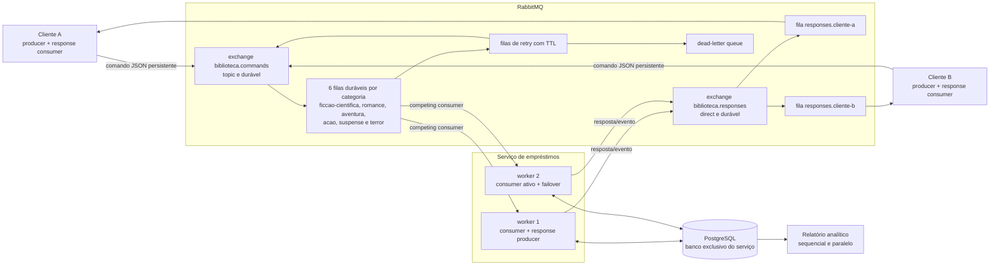

# Análise da `main` e plano da Parte 2

> **Atualização de implementação (25/11/2026):** o plano abaixo foi executado
> na branch `versao-simplificada`, criada a partir da `main`, sem consultar ou
> reutilizar branches anteriores de Parte 2. D-004 e D-012 foram aprovadas pela
> equipe. Código, testes e benchmarks estão implementados; resultados reais e
> eventuais diferenças operacionais do plano estão em
> [RESULTADOS_PARTE_2.md](RESULTADOS_PARTE_2.md) e a arquitetura final em
> [ARQUITETURA_PARTE_2.md](ARQUITETURA_PARTE_2.md).

Data da análise: 25/11/2026
Commit analisado: `1bd1553b4f79df124770f3f3dee589530b70de5f`
Escopo: branch `main`, `RULES.md`, rubrica fornecida em imagem, código, testes e
documentação existentes.

## 1. Conclusão executiva

A arquitetura proposta para a Parte 2 é viável e pode ser implementada sem
transformar o projeto em um conjunto excessivo de microsserviços. A solução
mais simples que cobre os requisitos é composta por:

1. clientes produtores e consumidores de respostas;
2. RabbitMQ para comandos assíncronos, separados por categoria;
3. duas instâncias do mesmo serviço de empréstimos, para processamento e
   recuperação após falha;
4. um PostgreSQL pertencente exclusivamente ao serviço de empréstimos;
5. um processo de relatório analítico, com versões sequencial e paralela;
6. Docker Compose para executar e demonstrar o sistema completo.

A `main` é uma base válida da Parte 1, mas ainda não atende à Parte 2. Ela possui
concorrência local e comunicação TCP síncrona, porém não possui broker,
persistência, processamento paralelo de CPU, benchmark comparativo ou
recuperação de um consumidor que falha.

## 2. Fontes e limites da análise

Foram considerados:

- `RULES.md`, localizado no diretório pai do repositório;
- cinco imagens da rubrica, com 8 critérios de 4 pontos, totalizando 32 pontos;
- todos os 12 arquivos rastreados pela `main`;
- execução local do código existente;
- documentação oficial do RabbitMQ e do PostgreSQL.

O `HEAD`, a branch local `main` e `origin/main` apontavam para o mesmo commit no
início da análise. O checkout local tinha o nome `versao-simplificada`, também
apontando para esse commit. Não havia alterações rastreadas pendentes. Após a
decisão da equipe, o checkout foi alterado para `main`, preservando somente as
mudanças documentais desta análise.

Por decisão da equipe, todo o planejamento e toda a implementação partirão
**exclusivamente da `main`**. Qualquer branch anterior de desenvolvimento da
Parte 2 está fora do escopo: não será consultada, auditada, reutilizada nem
considerada como evidência.

As novas imagens resolvem a divergência observada na primeira análise: o oitavo
critério é **Oral Presentation and Team Collaboration**. Esta revisão usa os
oito critérios e toma o nível **Exceeding (4 pontos)** como definição de pronto.
Partes inferiores de alguns cartões aparecem cortadas pela rolagem da
interface; nesses casos, o texto visível foi combinado com o requisito
correspondente do `RULES.md`, sem inventar exigências adicionais.

## 3. Inventário do estado atual

| Componente                | Responsabilidade atual                                               | Situação                                         |
| ------------------------- | -------------------------------------------------------------------- | -------------------------------------------------- |
| `biblioteca.py`         | Entidades `Livro`, `Estoque` e `Biblioteca`; lock e fila local | Funcional como protótipo em memória              |
| `network/protocolo.py`  | Protocolo TCP com cabeçalho de 5 bytes e payload UTF-8              | Bom enquadramento de mensagens                     |
| `network/servidor.py`   | Servidor TCP, uma thread por conexão e monitor local                | Síncrono, single-node e sem persistência         |
| `network/cliente.py`    | Cliente TCP bloqueante                                               | Adequado apenas à Parte 1                         |
| `test/servidor_test.py` | Servidor manual de teste com estoque reduzido                        | Script, não teste automatizado                    |
| `test/cliente_test.py`  | Carga concorrente e validações de caminho feliz/erro               | Útil, mas aleatório e não integrado a um runner |
| `ARQUITETURA.md`        | Diagramas da arquitetura da Parte 1                                  | Correto para o estado atual                        |
| `README.md`             | Explicação detalhada da concorrência e do protocolo               | Boa documentação da Parte 1                      |

### Pontos positivos que devem ser preservados

- Separação entre domínio e transporte: `biblioteca.py` não depende de sockets.
- Lock por título, permitindo concorrência entre estoques independentes.
- Fila FIFO local com `deque` e um `Event` por pedido.
- Espera fora da região crítica, evitando deadlock.
- Leitura TCP correta com laço até receber exatamente o tamanho informado.
- Caminhos explícitos de resposta e erro.
- Teste de carga que força clientes a iniciarem juntos.

## 4. Validações executadas

As verificações abaixo foram realizadas sem alterar a lógica da aplicação:

| Verificação                                           | Resultado                                                                     |
| ------------------------------------------------------- | ----------------------------------------------------------------------------- |
| Compilação de todos os módulos com Python 3.13.4     | Sucesso                                                                       |
| Descoberta com `unittest`                             | 0 testes; saída 5 (`NO TESTS RAN`)                                         |
| Envio/recebimento do protocolo usando um par de sockets | Sucesso                                                                       |
| Fluxo TCP com 30 clientes, Python em UTF-8              | 30 sucessos, 0 falhas, 21 clientes passaram pela fila, saída 0               |
| Mesmo script no console padrão do Windows              | Lógica concluiu, mas a impressão do emoji falhou em CP1252 e gerou saída 1 |
| Devolução sem empréstimo anterior                    | Estoque passou de 1/1 para 2/1; invariante violada                            |

O tempo observado no teste de 30 clientes foi 2,89 s, mas **não deve ser usado
como benchmark da Parte 2**: houve apenas uma repetição, as escolhas de livro e
os tempos de leitura são aleatórios, e não existe versão de comparação.

### Problemas atuais encontrados

1. Uma devolução não verifica a posse do exemplar e pode elevar o estoque acima
   da capacidade.
2. Todo o estado vive em memória e é perdido quando o servidor encerra.
3. Um cliente desconectado enquanto espera pode deixar um pedido local preso e
   receber logicamente um exemplar que não conseguirá devolver.
4. Não há timeout de conexão, retry, idempotência ou desligamento gracioso.
5. O payload é uma string livre; não há JSON versionado nem identificador de
   requisição.
6. O tamanho aceito pelo protocolo não tem limite.
7. `os.system("clear")` não é portável para Windows.
8. Os emojis do teste podem falhar em consoles sem UTF-8.
9. Os arquivos em `test/` são scripts manuais; nenhum teste é descoberto pelo
   `unittest`.
10. O teste é não determinístico e infere passagem pela fila usando um limite
    temporal de 100 ms, que pode ser instável entre máquinas.
11. As evidências de 2.000 threads no README não possuem script reproduzível no
    repositório.
12. Threads fornecem concorrência para I/O, mas não comprovam paralelismo de CPU
    nem ganho em uma tarefa pesada.

## 5. Aderência aos requisitos e à rubrica

Os níveis abaixo são um diagnóstico de prontidão, não uma atribuição oficial de
nota. A última coluna transforma o nível de 4 pontos em evidência verificável.

| Critério da rubrica | Evidência atual na `main` | Lacuna atual | Evidência necessária para o alvo 4/4 |
|---|---|---|---|
| Complete Distributed System: Architecture and End-to-End Execution | Cliente e servidor TCP rodam em processos diferentes; há diagrama da Parte 1 | A Parte 2 completa não roda em nós separados e reproduzíveis | Compose executando cliente, RabbitMQ, dois workers e PostgreSQL; fluxo completo ao vivo; diagrama com todos os nós e conexões; responsabilidade e justificativa de cada separação |
| Asynchronous Messaging | TCP bloqueante de requisição/resposta | Não há broker nem demonstração de recuperação de mensagem | Produtor e consumidor independentes; mensagens persistentes; confirms e ack manual; consumidor lento ou interrompido sem causar perda; retry e DLQ demonstrados |
| Parallel Processing with Measured Gain | Threads para I/O e espera | Não há tarefa pesada paralela nem comparação | Tarefa real de CPU; resultados corretos; sequencial comparado com várias contagens de processos; ganho medido; explicação de por que acelera e onde para de crescer |
| Performance Evaluation (Benchmark) | Uma evidência histórica e um script de carga | Método e resultados não são reproduzíveis nem interpretados como benchmark | Script versionado; métrica declarada; volume, repetições e ambiente; tabela/gráfico; mediana/p95; análise ligada à arquitetura, ao paralelismo e aos gargalos |
| Data Consistency | Locks em memória por estoque | Não há modelo distribuído declarado; a devolução pode corromper a capacidade | Consistência forte justificada; transações, locks e constraints; duas atualizações simultâneas disputando o último exemplar; banco permanece correto |
| Fault Tolerance | Desconexão de um cliente não derruba o servidor | Não há retry, failover ou recuperação de consumidor | Derrubar o consumidor ativo ao vivo; outro worker assume automaticamente, sem passo manual e sem perda; logs correlacionados; retry, timeout/redelivery e idempotência explicados |
| Artificial Intelligence Usage and Documentation | Diário resumido da Parte 1 e registro inicial desta etapa | Ainda não existe implementação da Parte 2 para explicar linha a linha | Diário contínuo com prompt exato, correções, sugestões aceitas/rejeitadas e justificativas; arquivos alterados; equipe capaz de explicar todo código auxiliado por IA |
| Oral Presentation and Team Collaboration | Não avaliável pelo repositório | Não há roteiro, divisão de fala ou ensaio registrado | Apresentação clara de 10 minutos; todos falam; demonstração ao vivo; todos respondem sobre arquitetura, código, consistência, falha, benchmark e IA |

Além da rubrica, a entrega exige instruções de execução e um relatório curto.
Eles deverão ser atualizados somente com resultados reais, sem números
inventados.

## 6. Arquitetura recomendada



### Responsabilidades

**Cliente**

- declara ou reutiliza uma fila de resposta identificada por `client_id`;
- publica `PEDIR` e `DEVOLVER` com `request_id` UUID;
- usa `correlation_id` para associar respostas;
- ignora respostas duplicadas já processadas;
- pode encerrar e voltar depois sem perder uma resposta ainda válida.

**RabbitMQ**

- desacopla clientes e serviço;
- roteia comandos para filas duráveis por categoria;
- mantém respostas em filas por cliente;
- faz redelivery de mensagens não confirmadas;
- envia falhas transitórias para retry e mensagens inválidas para DLQ.

**Serviço de empréstimos**

- contém as regras de catálogo, empréstimo, devolução e fila de espera;
- consome comandos com `auto_ack=False`;
- confirma a mensagem somente depois do commit no banco e da confirmação da
  publicação da resposta;
- produz respostas e notificações de liberação de exemplar;
- roda com duas instâncias do mesmo código no fluxo normal, sem criar
  microsserviços artificiais; o benchmark poderá escalar esse número.

**PostgreSQL**

- pertence ao serviço de empréstimos; clientes não o acessam diretamente;
- mantém livros, empréstimos, fila de espera e requisições já processadas;
- aplica transações, locks de linha e constraints.

**Relatório analítico**

- lê um conjunto determinístico de históricos de empréstimo;
- calcula métricas por categoria, como demanda, atrasos e títulos mais usados;
- possui implementações sequencial e paralela com a mesma saída.

## 7. Topologia de mensageria

### Comandos

- Exchange: `biblioteca.commands`, tipo `topic`, durável.
- Routing keys: `<categoria>.<acao>`, por exemplo `ficcao-cientifica.pedir` e
  `romance.devolver`.
- Filas: `biblioteca.commands.<categoria>`, duráveis.
- Categorias fixas: `ficcao-cientifica`, `romance`, `aventura`, `acao`,
  `suspense` e `terror`.
- Dois ou mais workers são **competing consumers** de todas as seis filas.
- Prefetch inicial igual a 1, simples e conservador; o benchmark poderá avaliar
  valores maiores sem alterar a semântica.
- Single Active Consumer não será usado no desenho inicial. A consistência e a
  ordem da espera pertencem ao PostgreSQL; serializar toda uma categoria faria
  um livro lento reduzir desnecessariamente o progresso dos demais.
- Falhas transitórias usam retry com atraso e limite; mensagens inválidas ou que
  excedem o limite vão para DLQ, sem loop de requeue.

### Análise da granularidade das filas

A escolha recomendada é **uma fila por categoria, não uma fila por livro**. Com
as categorias aprovadas existirão somente seis filas de comandos, portanto não
há o cenário de milhares de filas no MVP.

Uma falha ao processar um livro não significa que a fila da categoria caiu. O
worker trata a falha por mensagem: erro permanente vai para DLQ; erro transitório
vai para uma fila de retry; a fila principal continua entregando outros pedidos.
Com dois consumidores ativos e prefetch pequeno, um pedido lento ocupa no máximo
uma janela de entrega de um worker, enquanto o outro pode avançar.

Se a própria fila ficar indisponível, todos os livros daquela categoria aguardam.
Criar uma fila por livro não resolve a queda do RabbitMQ porque todas continuariam
no mesmo broker, e ainda multiplicaria processos internos, métricas, bindings,
consumidores e configuração. O isolamento de infraestrutura exigiria cluster e
replicação, mantidos para depois da segunda entrega. Se o benchmark revelar uma
categoria muito quente, a evolução simples é criar poucas partições por hash de
`book_id`, não milhares de filas.

| Falha | Efeito | Tratamento no MVP |
|---|---|---|
| Um pedido é inválido | Somente aquela mensagem falha | Rejeição sem requeue, DLQ e log |
| Um pedido sofre erro transitório | Pode atrasar aquele pedido | Retry com atraso e limite; a fila principal continua |
| Um worker ou seu canal cai | Mensagens sem ack voltam à fila | Outro competing consumer assume automaticamente |
| Uma fila está ausente ou sem binding | A publicação não pode ser aceita silenciosamente | Publicação `mandatory`, tratamento de `basic.return` e publisher confirm; o produtor só marca o comando como aceito quando ele foi roteado e confirmado |
| Uma categoria acumula backlog | Apenas aquela categoria aumenta latência | Métricas de profundidade/idade e workers compartilhados; avaliar partições somente se o benchmark justificar |
| O único broker cai | Todas as categorias ficam temporariamente indisponíveis | Reconexão com backoff e volume persistente; cluster fica para depois da entrega |

RabbitMQ usa um processo interno por fila e limita o caminho quente de uma
réplica de fila a um núcleo; múltiplas filas são esperadas, mas a quantidade deve
ser dimensionada e monitorada. Seis filas oferecem paralelismo por categoria sem
complexidade operacional desnecessária. Ver
[Queues](https://www.rabbitmq.com/docs/queues) e
[Consumer Acknowledgements](https://www.rabbitmq.com/docs/confirms).

### Respostas

- Exchange: `biblioteca.responses`, tipo `direct`, durável.
- Fila: `biblioteca.responses.<client_id>`, durável e com política de expiração.
- Binding key: o próprio `client_id`.
- A mensagem carrega o mesmo `request_id`/`correlation_id` do comando.
- O cliente normalmente permanece inscrito; se cair, pode reconectar com o
  mesmo `client_id` e consumir respostas ainda persistidas.

Uma fila compartilhada de respostas não será usada, pois clientes concorrentes
poderiam consumir respostas uns dos outros. `Direct Reply-to` também não é a
primeira escolha, porque a entrega precisa sobreviver à desconexão temporária do
cliente durante a demonstração de falha.

### Contrato mínimo da mensagem

```json
{
  "schema_version": 1,
  "request_id": "uuid",
  "client_id": "cliente-01",
  "action": "PEDIR",
  "book_id": "uuid",
  "category": "ficcao-cientifica",
  "sent_at": "2026-11-25T12:00:00Z"
}
```

A resposta deve conter `request_id`, `status`, dados ou erro, e um timestamp.
Uma devolução deve informar o `loan_id` recebido no empréstimo; título ou
`book_id` isolado não provam posse.
Mensagens com versão, ação, categoria ou campos inválidos vão para DLQ com log
estruturado, sem retry infinito.

## 8. Semântica de entrega e ausência de perda

O sistema adotará entrega **pelo menos uma vez**. Isso significa que uma
mensagem pode ser repetida após uma falha, portanto cada comando precisa ser
idempotente.

Fluxo do consumidor:

1. receber sem `auto_ack`;
2. iniciar transação no PostgreSQL;
3. procurar `request_id` em `processed_requests`;
4. se já existir, reutilizar a resposta gravada;
5. caso contrário, aplicar a regra e gravar estado + resultado na mesma
   transação;
6. confirmar o commit;
7. publicar a resposta como persistente e aguardar publisher confirm;
8. somente então enviar o `ack` do comando.

Se o processo cair depois do commit e antes do `ack`, o RabbitMQ entrega o
comando novamente. O `request_id` impede novo empréstimo e permite republicar a
mesma resposta. Se houver duplicata de resposta, o cliente também deduplica pelo
mesmo identificador.

### O que acontece quando um worker cai

| Momento da falha | Consequência e recuperação |
|---|---|
| Antes de receber uma mensagem | O outro worker continua consumindo normalmente |
| Depois de receber, antes do commit | A transação é revertida; ao fechar a conexão, a mensagem sem ack volta automaticamente à fila e outro worker a recebe |
| Depois do commit, antes de publicar a resposta | A mensagem volta à fila; `processed_requests` mostra que o efeito já ocorreu e o novo worker apenas republica a resposta salva |
| Depois de publicar, antes do ack | Pode existir resposta duplicada; `request_id` impede novo efeito no banco e permite ao cliente ignorar a duplicata |
| Todos os workers indisponíveis | Os comandos persistentes aguardam no RabbitMQ e voltam a ser processados quando ao menos um worker retornar |
| Mensagem sempre derruba ou falha no processamento | Retry limitado; depois do limite, DLQ e log, sem bloquear indefinidamente a categoria |

O worker não envia ack antes de terminar o fluxo seguro. O RabbitMQ documenta
que entregas sem ack são automaticamente reenfileiradas quando a conexão ou o
processo consumidor cai. Os consumidores precisam, portanto, ser idempotentes e
tratar o sinal de redelivery. O segundo worker já deve estar conectado; não há
comando manual de reinício ou promoção durante a demonstração.

Esse mecanismo cobre falha de worker. Um único container RabbitMQ ainda é um
ponto de indisponibilidade temporária: clientes devem reconectar e republicar
apenas comandos sem publisher confirm, enquanto filas duráveis e volume
persistente preservam o que já foi confirmado. Cluster do broker permanece no
backlog posterior à segunda entrega.

As recomendações se baseiam nos guias oficiais do RabbitMQ sobre
[acknowledgements e publisher confirms](https://www.rabbitmq.com/docs/confirms),
[confiabilidade](https://www.rabbitmq.com/docs/reliability),
[consumidores e Single Active Consumer](https://www.rabbitmq.com/docs/consumers)
e [dead-letter exchanges](https://www.rabbitmq.com/docs/dlx).

## 9. Consistência escolhida

O modelo principal será de **consistência forte** para estoque, empréstimos e
devoluções. Uma transação deve bloquear a linha do livro antes de verificar e
alterar `available_copies`. O PostgreSQL documenta `SELECT ... FOR UPDATE` para
proteger linhas contra atualizações concorrentes.

Invariantes mínimas:

- `0 <= available_copies <= total_copies`;
- um empréstimo não pode ser devolvido duas vezes;
- um cliente não pode devolver um exemplar que não tomou emprestado;
- um `request_id` produz no máximo uma alteração lógica;
- o primeiro pedido persistido na espera é o primeiro elegível quando houver
  devolução;
- empréstimo, alteração de estoque e registro idempotente pertencem à mesma
  transação.

Para corrigir a falha atual de devolução duplicada, `DEVOLVER` recebe `loan_id`
e `client_id`. Na mesma transação, o serviço bloqueia o empréstimo, confirma que
ele existe, pertence ao cliente e ainda está `ACTIVE`, muda-o para `RETURNED` e
só então libera ou transfere o exemplar. Uma segunda devolução do mesmo
`loan_id`, uma devolução de outro cliente ou uma devolução sem empréstimo ativo
é rejeitada sem alterar o estoque. Uma constraint no banco mantém
`available_copies` entre zero e `total_copies`, servindo como última barreira
contra corrupção.

Tabelas iniciais:

- `books`;
- `loans`;
- `waitlist`;
- `processed_requests`.

As notificações e a interface do cliente são assíncronas, mas o estado de
negócio confirmado no banco é forte. Essa distinção deverá ser explicada na
apresentação.

## 10. Fila de espera distribuída

Não se deve deixar uma mensagem `PEDIR` sem `ack` enquanto não houver exemplar.
Isso prende o consumidor, dificulta o desligamento e depende do timeout de
acknowledgement do broker.

Comportamento recomendado:

1. se houver exemplar, criar o empréstimo e responder `EMPRESTADO`;
2. se não houver, inserir o pedido em `waitlist` com sequência crescente,
   responder `NA_FILA` e confirmar o comando;
3. em uma devolução, selecionar o pedido de espera mais antigo dentro da
   transação, transferir o exemplar sem incrementar e decrementar o contador, e
   publicar `EMPRESTIMO_LIBERADO` para o cliente correspondente;
4. se não houver espera, incrementar `available_copies`.

Isso preserva a regra central da Parte 1 e torna a espera resistente a reinício.

## 11. Paralelismo real e benchmark

### Tarefa proposta

Gerar um relatório analítico sobre um histórico grande de empréstimos,
separado por categoria. Para cada categoria serão calculados demanda, número de
atrasos, dias de atraso, títulos mais emprestados e usuários ativos.

As categorias são independentes, então o mesmo cálculo pode ser executado:

- sequencialmente, uma categoria após a outra;
- em paralelo, com `ProcessPoolExecutor` e um processo por partição.

`threading` não será usado para esse item porque a tarefa é de CPU e o objetivo
é demonstrar paralelismo mensurável em Python.

### Metodologia planejada

- dataset determinístico, versionado ou gerado com seed fixa;
- volume inicial sugerido: pelo menos 1 milhão de eventos divididos em quatro
  ou mais categorias, ajustado após medição;
- uma execução de aquecimento e no mínimo cinco execuções medidas por
  configuração;
- mesma máquina, dataset e algoritmo;
- validação de que as saídas sequencial e paralela são idênticas;
- varredura com versão sequencial e 1, 2, 4 e `min(cpu_count, categorias)`
  processos, sem presumir que mais processos sempre serão melhores;
- coleta de mediana, p95, desvio, speedup `Tseq / Tpar` e eficiência
  `speedup / processos`;
- registro de CPU, núcleos, memória, sistema, Python e limites do Docker;
- resultado bruto em CSV e tabela/gráfico de tempo e speedup no relatório;
- identificação do ponto em que o ganho para de crescer;
- interpretação do custo de serialização, criação dos processos, contenção de
  CPU/memória/I/O e outros gargalos que expliquem a saturação.

Também será executado um benchmark separado de ponta a ponta com taxa de
comandos, latência mediana/p95, profundidade máxima das filas e tamanhos
diferentes de carga. Esse benchmark comparará 1, 2, 4 e, se o ambiente suportar,
6 instâncias do mesmo worker. O script, o volume, as repetições e o ambiente
serão registrados. Esse teste avalia a arquitetura e dirá se instâncias extras
reduzem latência ou apenas deslocam o gargalo para banco/broker, mas não
substitui a comparação sequencial/paralela da tarefa pesada.

Nenhum ganho será prometido antes das medições. Se o paralelo for mais lento, o
volume ou a granularidade devem ser analisados; os números não devem ser
selecionados ou alterados para favorecer a conclusão.

## 12. Demonstração de tolerância a falhas

Cenário mínimo reproduzível:

1. subir RabbitMQ, PostgreSQL e dois workers com `docker compose up --build`;
2. iniciar uma carga com comandos identificados;
3. derrubar deliberadamente o worker ativo antes do `ack`;
4. sem reiniciar ou intervir, observar o segundo worker receber a mensagem
   redelivered;
5. confirmar que o cliente recebe resposta;
6. consultar o banco e provar que existe somente uma alteração lógica para o
   `request_id`;
7. apresentar logs com timestamps, worker, request ID e estado de redelivery;
8. repetir com um consumidor artificialmente lento e provar que a mensagem
   permanece na fila ou segue a política de retry, sem desaparecer.

O escopo mínimo tolera falha de consumidor. Um cluster RabbitMQ e replicação do
PostgreSQL seriam melhorias de produção, mas aumentariam muito a complexidade e
não são necessários para demonstrar o requisito inicial. Volumes e políticas de
reinício ainda devem ser usados para recuperar os containers locais.

## 13. Apresentação oral e colaboração

O oitavo critério exige participação real da equipe, não apenas uma boa
demonstração técnica. O roteiro final deve caber em 10 minutos:

| Tempo | Conteúdo |
|---|---|
| 0:00–1:00 | problema, fluxo e responsabilidades dos nós |
| 1:00–3:00 | RabbitMQ, filas por categoria, confirmações e respostas |
| 3:00–5:00 | PostgreSQL, consistência forte e conflito simultâneo |
| 5:00–7:00 | tarefa paralela, método, gráfico, ganho e saturação |
| 7:00–9:00 | falha ao vivo do worker e recuperação automática |
| 9:00–10:00 | conclusões, limitações e uso de IA |

Todos os integrantes devem falar e cada um deve conhecer o fluxo completo, não
somente o próprio trecho. Antes da entrega, a equipe deve realizar pelo menos um
ensaio cronometrado e uma rodada de perguntas cruzadas sobre:

- por que cada serviço foi separado;
- quando o `ack` é enviado e como duplicatas são tratadas;
- como o banco impede dois empréstimos do último exemplar;
- por que o paralelo acelera e por que satura;
- o que acontece exatamente quando o worker ativo é encerrado;
- quais sugestões da IA foram aceitas, corrigidas ou rejeitadas.

Uma gravação ou capturas podem servir como contingência, mas não substituem a
demonstração ao vivo exigida para o nível máximo.

## 14. Estrutura sugerida

```text
.
├── src/
│   ├── client/
│   ├── common/
│   │   ├── config.py
│   │   ├── messages.py
│   │   └── topology.py
│   └── loan_service/
│       ├── consumer.py
│       ├── domain.py
│       ├── repository.py
│       └── database.py
├── migrations/
├── tests/
│   ├── unit/
│   └── integration/
├── benchmarks/
├── scripts/
├── docs/
├── Dockerfile
├── compose.yaml
└── requirements.txt
```

O código da Parte 1 deve permanecer disponível durante a migração como
referência de regra, mas não deve continuar sendo a fonte de verdade do estoque
depois que o PostgreSQL entrar em uso.

## 15. Plano incremental de implementação

### Etapa 0 — preservar a linha de base

- criar testes automatizados e determinísticos para as regras atuais;
- corrigir a devolução sem posse e validar invariantes;
- tornar configuração e logs portáveis.

### Etapa 1 — persistência e consistência

- definir migrations e repositórios;
- implementar transações de empréstimo, espera e devolução;
- exigir `loan_id` e posse válida para devolver, com teste de devolução
  duplicada e de devolução por outro cliente;
- testar duas requisições simultâneas disputando o último exemplar;
- implementar `processed_requests`.

### Etapa 2 — mensageria

- declarar exchanges, filas, bindings, retry e DLQ;
- implementar cliente produtor/consumidor de resposta;
- implementar worker com ack manual, confirms e idempotência;
- testar redelivery, consumidor lento, limite de retry e mensagens inválidas na
  DLQ.

### Etapa 3 — execução distribuída

- criar imagem e Compose com healthchecks;
- executar dois workers;
- validar fluxo ponta a ponta e failover automático do worker, sem comando de
  reinício após a falha.

### Etapa 4 — paralelismo e desempenho

- implementar relatório sequencial e paralelo;
- criar dataset determinístico;
- executar benchmark com diferentes contagens de processos;
- exportar os dados e gerar gráficos de tempo, speedup e latência;
- interpretar os gargalos e o ponto de saturação.

### Etapa 5 — entrega e demonstração

- atualizar README e diagrama com o que foi realmente implementado;
- registrar teste de falha e resultados;
- finalizar relatório de IA com prompts e mudanças rastreáveis;
- preparar e ensaiar o roteiro de 10 minutos com participação de todos.

## 16. Critérios de conclusão

A Parte 2 somente estará concluída quando:

- um comando sair de um cliente, atravessar RabbitMQ, for persistido pelo
  serviço e voltar ao cliente por uma fila de resposta;
- o diagrama representar todos os nós e conexões usados na demonstração, com
  justificativa de cada separação;
- houver pelo menos duas instâncias de worker e recuperação demonstrada;
- a queda de um worker for recuperada automaticamente por outra instância, sem
  reinício manual, perda ou duplicação do efeito lógico;
- consumidor lento e consumidor interrompido não causarem perda de mensagens;
- conflito pelo último exemplar for resolvido corretamente no banco;
- devolução duplicada, sem posse ou de outro cliente for rejeitada sem alterar
  o estoque;
- fila de espera continuar FIFO e sobreviver a reinício;
- tarefa sequencial e paralela produzir o mesmo resultado e tiver números
  reproduzíveis;
- o teste variar a quantidade de processos e explicar o ganho e sua saturação;
- benchmark registrar métricas, volume, metodologia, ambiente, repetições,
  tabela/gráfico e interpretação dos gargalos;
- o benchmark distribuído comparar diferentes quantidades de workers;
- `docker compose up --build` e os testes estiverem documentados;
- o relatório de IA registrar prompts exatos, mudanças, correções e sugestões
  aceitas/rejeitadas com justificativa;
- todos os integrantes participarem do ensaio de 10 minutos e conseguirem
  responder perguntas sobre qualquer fluxo essencial do sistema.
