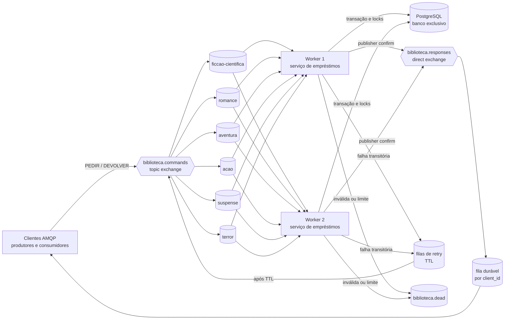
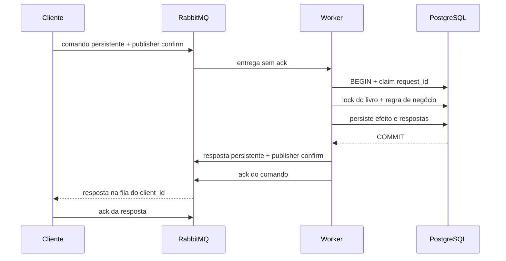

# Arquitetura implementada — Parte 2

## Visão geral

## Por que cada nó existe

| Nó | Responsabilidade | Justificativa da separação |
|---|---|---|
| Cliente | Publicar comandos e consumir respostas do próprio `client_id` | Não conhece banco nem executa regra de negócio; pode desconectar e reconectar |
| RabbitMQ | Persistir, rotear e reentregar mensagens | Desacopla tempo de vida e velocidade de produtores e consumidores |
| Workers | Validar contrato e executar empréstimo/devolução | Podem escalar como instâncias equivalentes e uma assume quando outra cai |
| PostgreSQL | Manter catálogo, empréstimos, espera e idempotência | É a autoridade única para invariantes e consistência forte |
| Processo analítico | Calcular relatório por categoria em processos | É uma tarefa de CPU independente do caminho transacional |

Os dois workers são instâncias do mesmo serviço lógico, não dois
microsserviços artificiais. Ambos consomem as seis filas como *competing
consumers*. O PostgreSQL serializa apenas comandos sobre o mesmo livro com
`SELECT ... FOR UPDATE`; livros diferentes continuam independentes.

## Topologia e entrega

- Seis filas duráveis de comandos, uma por categoria aprovada.
- Mensagens persistentes e `publisher confirm` no produtor.
- `prefetch=1` e `ack` manual somente depois do commit e da confirmação das
  respostas.
- Uma fila de resposta durável por `client_id`, com expiração após inatividade e
  TTL das mensagens.
- Uma fila de retry por categoria, com TTL e retorno automático ao exchange de
  comandos.
- Uma DLQ compartilhada para mensagens inválidas ou que excederam o limite de
  tentativas.
- Sem Single Active Consumer: livros diferentes da mesma categoria não são
  serializados desnecessariamente.

Criar uma fila por livro foi rejeitado. Isso multiplicaria filas, bindings e
métricas sem proteger contra a queda do broker. Uma mensagem problemática é
isolada por retry/DLQ; a indisponibilidade do RabbitMQ inteiro é uma limitação
de infraestrutura explicitamente deixada para o backlog pós-entrega.

## Fluxo transacional

`processed_requests.request_id` fornece idempotência. Se o worker cair depois do
commit e antes do ack, RabbitMQ reentrega o comando; a nova instância lê e
republica a resposta já persistida em vez de repetir o efeito.

## Consistência e fila de espera

O modelo é de consistência forte para estoque, empréstimos, devoluções e espera.
Transações, locks de linha, índices únicos e constraints garantem:

- `0 <= available_copies <= total_copies`;
- no máximo um empréstimo ativo do mesmo livro por cliente;
- devolução somente pelo dono de um empréstimo ativo;
- uma requisição de espera ativa por cliente/livro;
- ordem FIFO pela chave crescente da tabela `waitlist`.

Quando não há exemplar, o comando recebe `NA_FILA` e é confirmado. A posição
continua no banco. Uma devolução transfere diretamente o exemplar ao primeiro
pedido e publica `EMPRESTIMO_LIBERADO`; nesse caminho o estoque não é
incrementado e decrementado, evitando duplicidade.

## Falhas observadas

| Momento da queda | Resultado |
|---|---|
| Antes do commit | PostgreSQL desfaz a transação; a mensagem sem ack volta à fila |
| Depois do commit, antes da resposta/ack | O outro worker reprocessa por `request_id` e republica a mesma resposta |
| Cliente desconectado | A resposta permanece na fila durável e é entregue após reconexão com o mesmo ID |
| Mensagem inválida | Vai para DLQ com erro e routing key original nos headers |
| Todos os workers indisponíveis | Comandos persistentes aguardam; o serviço retoma quando uma instância volta |

A demonstração versionada derruba deliberadamente o processo com `os._exit(70)`
depois do commit. Essa injeção só funciona quando
`ENABLE_FAULT_INJECTION=true`, configuração usada no ambiente de demonstração.

## Limitações assumidas

- RabbitMQ e PostgreSQL possuem uma instância no Compose; falha de consumidor é
  coberta, falha total do broker/banco não.
- O cliente acadêmico possui credencial AMQP; um gateway fica para pós-entrega.
- Não há autenticação/autorização de usuários além do `client_id`.
- Métricas são coletadas pelos scripts de benchmark, sem stack permanente de
  observabilidade.
