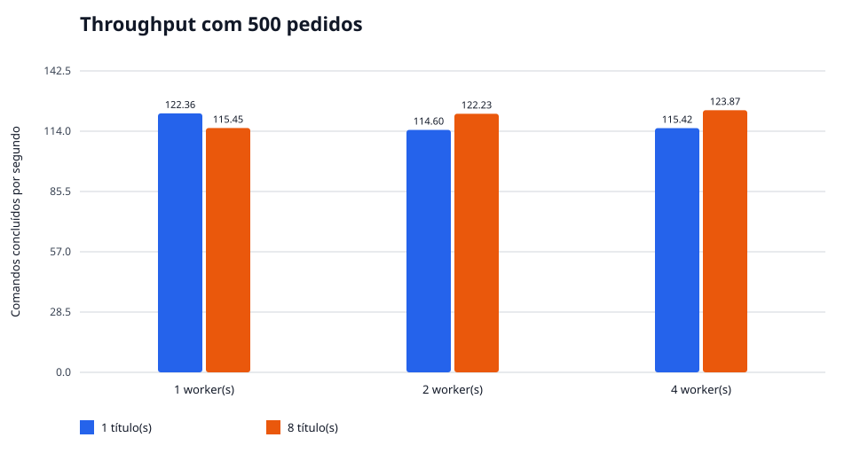
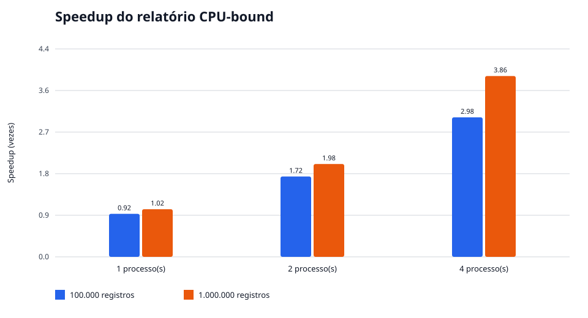

# Etapa 6 — Escalabilidade distribuída e paralelismo CPU

**Execução:** 22/11/2026 (America/Fortaleza) · **Dados:** benchmarks sintéticos
reproduzíveis executados com PostgreSQL e RabbitMQ reais.

## Resumo executivo

Os workers distribuídos escalam apenas quando há trabalho independente. Com
500 pedidos para um único título, a mediana caiu de **122,36 comandos/s** com um
worker para **115,42 comandos/s** com quatro (-5,7%), porque o lock persistente
por livro serializa o caminho crítico. Com oito títulos, o throughput subiu de
**115,45 para 123,87 comandos/s** (+7,3%) e o backlog no instante da conclusão
caiu de 23 para zero. O ganho é real, mas modesto, enquanto o RSS agregado
passou de aproximadamente 43 para 171 MB.

O relatório CPU-bound apresentou outra característica: paralelismo por
processos. Para 100 mil registros, quatro processos atingiram speedup de
**2,98×** e eficiência de **0,74**; para um milhão, atingiram **3,86×** e
eficiência de **0,97**. O volume maior amortizou melhor o custo de criação dos
processos, serialização e combinação dos resultados. Todas as 40 saídas
medidas tiveram o mesmo fingerprint da implementação sequencial
correspondente.

Foram concluídos **18.000 comandos distribuídos**, sem erros ou rejeições, em
60 execuções medidas. Aceite pelo Gateway e conclusão do empréstimo foram
medidos separadamente; portanto, throughput de aceite não é apresentado como
throughput de negócio.

## Ambiente e método

| Item | Configuração |
|---|---|
| Host | Windows 11 10.0.26200, CPU Intel Family 6 Model 183, 32 CPUs lógicas, 31,71 GiB RAM |
| Runtime Docker | WSL2/Linux 6.6.87.2, 8 CPUs lógicas, 15,62 GiB RAM |
| Python | 3.13.4 |
| PostgreSQL | 16.16 Alpine |
| RabbitMQ | 4.4.1 |
| Docker / Compose | 29.6.1 / v5.2.0 |
| Limites explícitos | Nenhum limite de CPU ou memória no Compose |
| Repetições | 1 aquecimento descartado + 5 medições por configuração |

O benchmark final rodou dentro de uma rede Docker isolada. PostgreSQL,
RabbitMQ, orquestrador e subprocessos dos workers usaram nomes de serviço e
portas internas, evitando que o NAT do host influenciasse o resultado. Uma
tentativa preliminar pelo encaminhamento de porta do Windows atingiu o erro
`10048` por muitas conexões curtas em `TIME_WAIT`; seus resultados foram
descartados integralmente.

### A. Throughput distribuído

A matriz combinou:

- 100 pedidos, concorrência 8, com 1 ou 8 títulos;
- 500 pedidos, concorrência 32, com 1 ou 8 títulos;
- 1, 2 e 4 processos de worker;
- banco recriado/seed aplicado e filas purgadas antes de cada rodada;
- livros exclusivos com capacidade suficiente para concluir todos os pedidos.

Cada cliente abriu uma conexão TCP real com o Gateway. O publisher da outbox e
os workers usaram conexões RabbitMQ/PostgreSQL independentes. O relógio de
conclusão parou somente quando todas as solicitações persistidas ficaram
`CONCLUIDO` ou `REJEITADO`.

Métricas:

```text
throughput_aceite = pedidos RECEBIDO / tempo até o último aceite
throughput_conclusao = pedidos CONCLUIDO / tempo ponta a ponta
espera_fila = instante observado de conclusão - instante do aceite
```

Latências p50/p95/p99 usam *nearest-rank*. CPU é o tempo agregado dos processos
de worker dividido pelo tempo observado; pode ultrapassar 100% quando mais de
um núcleo é usado. RSS é o pico agregado, amostrado a cada 50 ms.

### B. Relatório CPU-bound

O algoritmo gera e processa deterministicamente um histórico de empréstimos
por intervalos independentes. Ele calcula histograma e percentis de espera,
SLA de 60 minutos, empréstimos atrasados, ranking por título/usuário e checksum.
Não há `sleep()` na tarefa computacional.

A implementação sequencial e a paralela recebem a mesma seed e os mesmos
limites. `ProcessPoolExecutor` divide os intervalos entre 1, 2 ou 4 processos e
combina histogramas e agregações inteiras. Antes de registrar cada tempo, um
SHA-256 de toda a saída é comparado ao baseline sequencial.

```text
speedup = mediana_tempo_sequencial / mediana_tempo_paralelo
eficiencia = speedup / numero_de_processos
```

## Resultados distribuídos

### 500 pedidos, concorrência 32

| Títulos | Workers | Conclusão (ops/s) | Speedup vs. 1 | Aceite p95 (ms) | Conclusão p95 (ms) | Backlog ao concluir | CPU workers | RSS pico |
|---:|---:|---:|---:|---:|---:|---:|---:|---:|
| 1 | 1 | 122,36 | 1,000× | 836,6 | 4.007,5 | 219 | 9,1% | 43,3 MB |
| 1 | 2 | 114,60 | 0,937× | 878,4 | 4.279,7 | 213 | 14,2% | 86,0 MB |
| 1 | 4 | 115,42 | 0,943× | 857,1 | 4.274,9 | 197 | 21,9% | 171,6 MB |
| 8 | 1 | 115,45 | 1,000× | 310,0 | 3.902,2 | 23 | 18,8% | 42,9 MB |
| 8 | 2 | 122,23 | 1,059× | 303,7 | 3.882,5 | 4 | 21,0% | 86,0 MB |
| 8 | 4 | 123,87 | 1,073× | 309,1 | 3.885,7 | 0 | 22,7% | 171,3 MB |



O único título concentra tanto a atribuição de `ordem_fila` no Gateway quanto
o processamento sob `SELECT ... FOR UPDATE` na mesma linha de livro. Mais
workers aumentam competição e memória, sem criar novos caminhos paralelos. Em
oito títulos, locks diferentes podem avançar simultaneamente; quatro workers
também consumiram todos os eventos até o instante em que o último pedido ficou
concluído.

O backlog não significa pedido perdido. `processar_pedidos()` pode concluir
vários pedidos FIFO elegíveis ao consumir um único evento; os eventos restantes
são idempotentes e ainda precisam de ACK. A métrica é registrada para não
confundir estado de negócio concluído com fila técnica totalmente drenada.

### 100 pedidos, concorrência 8

| Títulos | Workers | Conclusão (ops/s) | Speedup vs. 1 | Conclusão p95 (ms) | Backlog ao concluir |
|---:|---:|---:|---:|---:|---:|
| 1 | 1 | 129,67 | 1,000× | 745,1 | 39 |
| 1 | 2 | 132,15 | 1,019× | 749,4 | 32 |
| 1 | 4 | 108,82 | 0,839× | 913,6 | 20 |
| 8 | 1 | 84,74 | 1,000× | 886,8 | 20 |
| 8 | 2 | 92,75 | 1,095× | 907,2 | 5 |
| 8 | 4 | 96,15 | 1,135× | 931,6 | 0 |

No volume pequeno, startup, agendamento e custo fixo têm maior peso. O cenário
de oito títulos ainda melhora throughput ao adicionar workers, mas p95 de
conclusão não melhora; o ganho está na taxa agregada e na drenagem da fila, não
em menor latência de cauda para cada pedido.

## Resultados do relatório CPU-bound

| Registros | Modo | Processos | Tempo mediano | Registros/s | Speedup | Eficiência |
|---:|---|---:|---:|---:|---:|---:|
| 100.000 | sequencial | 1 | 0,2048 s | 488.308 | 1,00× | 1,00 |
| 100.000 | pool | 1 | 0,2232 s | 447.980 | 0,92× | 0,92 |
| 100.000 | pool | 2 | 0,1194 s | 837.784 | 1,72× | 0,86 |
| 100.000 | pool | 4 | 0,0688 s | 1.454.486 | 2,98× | 0,74 |
| 1.000.000 | sequencial | 1 | 2,2245 s | 449.548 | 1,00× | 1,00 |
| 1.000.000 | pool | 1 | 2,1872 s | 457.210 | 1,02× | 1,02 |
| 1.000.000 | pool | 2 | 1,1219 s | 891.370 | 1,98× | 0,99 |
| 1.000.000 | pool | 4 | 0,5762 s | 1.735.587 | 3,86× | 0,97 |



O pool com um processo evidencia o custo de criar processo e combinar
resultados: em 100 mil registros ele ficou cerca de 8% mais lento que o
sequencial. Nesse volume, quatro processos também perdem eficiência para
overhead e lotes pequenos. Em um milhão, o trabalho por lote é suficiente para
amortizar o IPC e usar os quatro processos com eficiência observada de 0,97; a
pequena vantagem do pool de um processo sobre o sequencial está dentro da
variação das cinco repetições e não representa paralelismo.

Esse speedup computacional não é equivalente à escalabilidade dos workers. O
relatório divide lotes CPU-bound independentes; o empréstimo distribuído
coordena estado compartilhado no PostgreSQL e pode ser serializado pelo lock de
um mesmo título.

## Reprodutibilidade

> **Atenção:** o benchmark trunca as tabelas de negócio entre rodadas. Use um
> projeto Compose isolado; nunca a base que contém dados a preservar.

Exemplo PowerShell com volumes e portas exclusivos:

```powershell
$env:COMPOSE_PROJECT_NAME="biblioteca-benchmark-etapa6"
$env:POSTGRES_PORT="5544"
$env:RABBITMQ_PORT="5673"
$env:RABBITMQ_MANAGEMENT_PORT="15673"

docker compose build gateway
docker compose up -d postgres rabbitmq
docker compose run --rm migrate
docker compose stop gateway publisher worker

New-Item -ItemType Directory -Force benchmark/resultados | Out-Null
docker compose run --rm --no-deps `
  -v "${PWD}/benchmark/resultados:/resultados" `
  gateway python -m benchmark.executar `
  --modo todos `
  --confirmar-banco-de-benchmark `
  --repeticoes 5 `
  --cpu-volumes 100000 1000000 `
  --saida /resultados

docker compose down -v
```

O `compose run` usa a rede interna dos serviços, enquanto o bind mount preserva
os artefatos no host. `down -v` remove somente os volumes do projeto isolado
definido em `COMPOSE_PROJECT_NAME`.

Arquivos de evidência:

- [medições distribuídas brutas](../benchmark/resultados/throughput_raw.csv);
- [resumo distribuído](../benchmark/resultados/throughput_resumo.csv);
- [medições CPU brutas](../benchmark/resultados/cpu_raw.csv);
- [resumo CPU](../benchmark/resultados/cpu_resumo.csv);
- [ambiente capturado](../benchmark/resultados/ambiente.json).

## Validação automatizada

```text
test/test_benchmark.py: 5 passed in 3.67s
suíte completa: 47 passed in 21.68s
auditoria dos CSVs/SVGs: OK
invariantes persistentes: ok=true, DLQ=0, outbox pendente=1
```

Os testes verificam percentis, agrupamento das repetições, speedup/eficiência,
equivalência sequencial-paralela e uma carga real curta com Gateway, outbox,
RabbitMQ e dois processos de worker. A única outbox pendente é o resíduo
esperado do teste de atomicidade, que termina antes da publicação; ela não
corresponde a pedido perdido nem viola as invariantes.

## Limitações e diagnóstico

- Os resultados descrevem uma máquina e uma execução controlada; não são uma
  capacidade contratual nem substituem teste multi-host.
- As cinco repetições mostram variação observada, não intervalo de confiança.
- A ordem das configurações foi fixa; aquecimento reduz, mas não elimina,
  efeitos de cache, frequência da CPU e carga de fundo.
- Os dados do relatório CPU são sintéticos e determinísticos. O algoritmo é
  representativo de agregação de histórico, mas a distribuição de produção
  pode mudar custos e ranking.
- O padrão de conexão curta ao PostgreSQL esgotou portas efêmeras quando o
  benchmark foi tentado via NAT do Windows. A execução final na rede Docker é
  válida e reproduzível, mas o achado indica que pool de conexões é uma melhoria
  importante antes de carga sustentada pelo host.
- Mais workers aumentaram RSS quase linearmente. Para um título contendido, o
  custo adicional não trouxe ganho; a recomendação é escalar workers conforme
  diversidade de títulos/partições, não apenas pelo tamanho bruto da fila.

